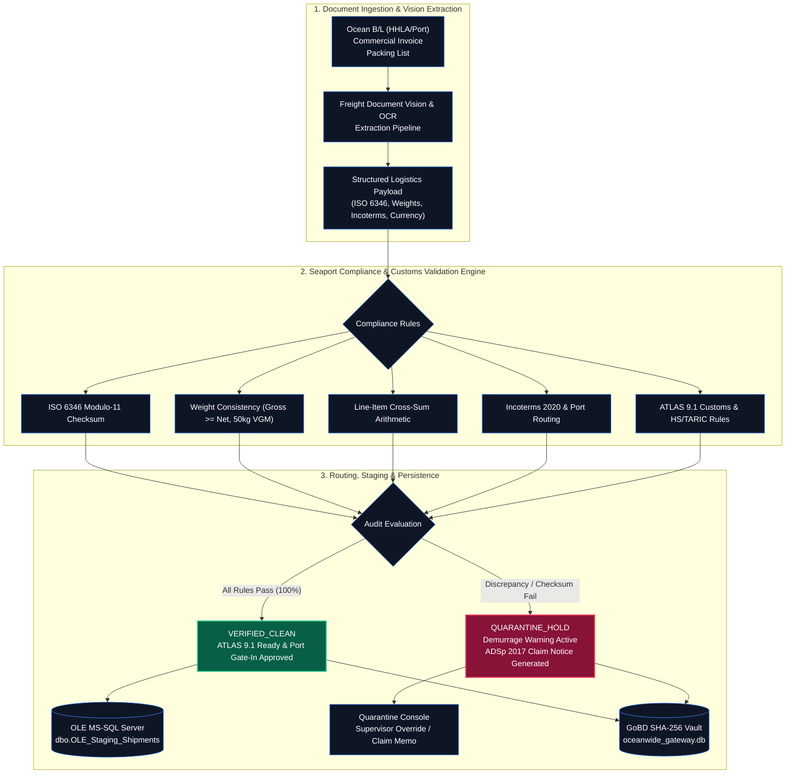

# Oceanwide Gateway (OLE Gateway)
### Automated Freight Document Ingestion & Port of Hamburg Customs Compliance Engine

[](https://oceanwide-gateway.onrender.com)
[](https://oceanwide-gateway.onrender.com/health)
[-0369a1?style=flat-square)](https://oceanwide-gateway.onrender.com)
[](https://www.python.org/)
[](https://fastapi.tiangolo.com/)
[](https://www.docker.com/)
[](https://www.spediteure.de/adsp/)

Engineered for operational seaport and customs processing at **[OLE Oceanwide Logistics Europe GmbH](https://www.oceanwidelogistics.net/)** & **[Oceanwide Logistics Global Network (OLGN)](https://www.oceanwidelogistics.net/)**  
*Süderstraße 77, 20097 Hamburg, Germany · Commercial Register: Amtsgericht Hamburg, HRB 122583*  
*Managing Directors (Geschäftsführung): Peter Czajkowski (CEO) & Christoph Braß*

---

> **Live Service:** [https://oceanwide-gateway.onrender.com](https://oceanwide-gateway.onrender.com)  
> **API Documentation (OpenAPI/Swagger):** [https://oceanwide-gateway.onrender.com/docs](https://oceanwide-gateway.onrender.com/docs)  
> **Health Probe:** [https://oceanwide-gateway.onrender.com/health](https://oceanwide-gateway.onrender.com/health)

---

## 1. Overview & Operational Scope

**Oceanwide Gateway (OLE Gateway)** is an enterprise document ingestion, 3-Way Match cross-reconciliation, and customs compliance validation service tailored specifically for **OLE Oceanwide Logistics Europe GmbH** seaport operations in Hamburg.

Operating at the heart of Germany's primary maritime hub (Port of Hamburg: HHLA Burchardkai CTB, Altenwerder CTA, Tollerort CTT, and Eurogate CTH), alongside gateways in Rotterdam, Antwerp, and Bremerhaven, the gateway ingests multi-format freight documents (Ocean Bills of Lading, Commercial Invoices, Packing Lists, and Air Waybills), extracts and validates critical transport document data (B/L numbers, ISO container check digits, gross/tare/net weights, Colli counts, Incoterms 2020, and commercial invoice line items) against maritime and customs standards before ERP staging and German **ATLAS 9.1** customs submission.

### Operational Objectives
1. **Container Gate-In & Demurrage Mitigation:** Performs instant ISO 6346 Modulo-11 check digit verification and 50-kg VGM weight tolerance validation (§ 412 HGB / SOLAS VGM), eliminating gate-in rejections and terminal detention fines (€150 to €350 per day/container).
2. **Automated 3-Way Match Reconciliation:** Cross-audits the transport document triad (Ocean B/L vs. Commercial Invoice vs. Packing List), verifying line items, container serials, Colli counts, gross/net weights, Incoterms, and financial totals across all three documents.
3. **Legal Claim Notice Generation (ADSp 2017):** Automatically formulates legally binding German carrier discrepancy memos under ADSp 2017 § 19 and § 412 HGB when weight discrepancies or equipment mismatches are identified.
4. **Decoupled Enterprise TMS/ERP Staging:** Generates parameterized Transact-SQL (T-SQL) DDL schemas and scripts for `[dbo].[OLE_Staging_Shipments]` and `[dbo].[OLE_Staging_ReconciliationTriad]`, accompanied by a native C# / .NET 8 integration driver.
5. **GoBD Cryptographic Audit Trail:** Binds every processed shipment and operator supervisor override to an immutable SHA-256 ledger adhering to German tax and archiving requirements (§ 146, 147 AO / GoBD).

---

## 2. System Architecture



---

## 3. Core Validation Modules

### 1. Three-Way Match Cross-Reconciliation (Triad Audit)
Cross-checks the primary logistics document set for ocean freight:
* **Ocean Bill of Lading (B/L)** vs. **Commercial Invoice** vs. **Packing List**.
* Verifies container numbers, package quantities (Colli), gross and net weights, currencies, and Incoterms across all three records.
* Discrepancies exceeding the 50-kg mass balance trigger an immediate `QUARANTINE_HOLD` and calculate prevented demurrage.

### 2. ISO 6346 Modulo-11 Container Validation Engine
Calculates the standard ISO 6346 checksum algorithm for intermodal freight containers:
$$\text{Checksum} = \left( \sum_{i=0}^{9} \text{Value}(c_i) \times 2^i \right) \pmod{11} \pmod{10}$$
* Identifies transposed container serial numbers before drivers arrive at HHLA Burchardkai, Altenwerder, or Eurogate terminals.

### 3. Mass Balance & Weight Verification (§ 412 HGB / SOLAS VGM)
Validates that declared gross weights strictly exceed net weights and conform to SOLAS VGM requirements under Section 412 of the German Commercial Code (HGB). Flags tare discrepancies exceeding 50 kg.

### 4. Legal Claim Notice Generator (ADSp 2017)
Produces formal carrier discrepancy notices citing **ADSp 2017 Section 19** and **§ 412 HGB** with 1-click clipboard and email generation, enabling dispatchers to file immediate reservations against shipping lines (e.g., Maersk, Hapag-Lloyd, MSC).

### 5. GoBD Cryptographic Audit Trail (§ 147 AO)
Binds every document extraction, deterministic audit result, and supervisor override with an SHA-256 cryptographic signature, exportable as an official German customs compliance protocol (ATLAS 9.1).

---

## 4. Technology Stack

| Component | Technology | Operational Function |
| :--- | :--- | :--- |
| **API Framework** | FastAPI (Python 3.11) | Asynchronous REST API with Pydantic v2 schemas |
| **Entity Extraction** | Google Gemini Vision API | Structured multimodal OCR and key-value mapping |
| **Validation Engine** | Deterministic Pure Python | ISO 6346 Modulo-11, weight balance, and financial arithmetic |
| **Persistence** | SQLite 3 / MS-SQL Server | Local audit ledger (`oceanwide_gateway.db`) & T-SQL staging bridge |
| **Frontend UI** | Modern Responsive SPA | HTML5, Tailwind CSS, FontAwesome 6, Vanilla ES6 JavaScript |
| **Document Spec Engine** | PyMuPDF (fitz) & Chromium | Automated PDF technical integration spec generation |
| **Containerization** | Docker | Non-root Debian-slim image meeting CIS container standards |

---

## 5. Local Setup & Quickstart

### Prerequisites
* Python 3.11+
* Git

### Step 1: Clone Repository
```bash
git clone https://github.com/AllenFletcherAI/Oceanwide-Gateway.git
cd Oceanwide-Gateway
```

### Step 2: Install Dependencies
```bash
pip install -r requirements.txt
```

### Step 3: Configure Environment
Ensure your `.env` file in the project root is configured:
```env
GEMINI_API_KEY="your-google-gemini-api-key"
PORT=8000
HOST=0.0.0.0
ENVIRONMENT=production
COMPANY_NAME="OLE Oceanwide Logistics Europe GmbH"
PARTNER_NAME="Oceanwide Logistics Global Network (OLGN)"
GATEWAY_NAME="Oceanwide Gateway"
DATABASE_URL="sqlite:///./oceanwide_gateway.db"
```

### Step 4: Run Application
```bash
python run.py
```
* **Interactive Workspace UI**: `http://localhost:8000`
* **Swagger OpenAPI Docs**: `http://localhost:8000/docs`
* **Health Probe**: `http://localhost:8000/health`

### Alternative: Run with Docker
```bash
docker build -t oceanwide-gateway .
docker run -p 7860:7860 -e GEMINI_API_KEY="your-key" oceanwide-gateway
```

---

## 6. REST API Reference

| Method | Endpoint | Description |
| :--- | :--- | :--- |
| `GET / HEAD` | `/` | Operational dashboard UI |
| `GET / HEAD` | `/health` | Service health, version, and company telemetry probe |
| `GET` | `/api/v1/metrics` | Processing metrics (total shipments, clean count, quarantine count) |
| `POST` | `/api/v1/documents/process` | Upload document for vision OCR extraction and deterministic audit |
| `GET` | `/api/v1/sample/{doc_type}` | Pre-loaded sample transport documents for testing |
| `GET` | `/api/v1/reconcile-samples` | Three-way dossier sample set (B/L, Commercial Invoice, Packing List) |
| `POST` | `/api/v1/reconcile-simulation` | Executes cross-document 3-Way Match reconciliation |
| `POST` | `/api/v1/reconcile-live` | Multipart upload for live 3-Way Match cross-audit |
| `GET` | `/api/v1/recent` | Recent audit ledger entries from `oceanwide_gateway.db` |
| `POST` | `/api/v1/quarantine/override` | Records authorized supervisor release on quarantined shipment |
| `GET` | `/api/v1/integration/mssql-ddl` | Transact-SQL schema DDL for OLE MS-SQL Server staging tables |
| `GET` | `/api/v1/integration/client-snippets` | C# .NET 8, cURL, Python, and webhook integration snippets |

---

## 7. Enterprise TMS Integration (OLE Hamburg)

### Target Database Schema ([dbo].[OLE_Staging_Shipments])
```sql
CREATE TABLE [dbo].[OLE_Staging_Shipments] (
    [StagingID]             INT IDENTITY(1,1) PRIMARY KEY,
    [ShipmentRef]           NVARCHAR(50)   NOT NULL,
    [ContainerNumber]       NVARCHAR(11)   NULL,          -- ISO 6346 (z.B. 'MSKU2264802')
    [SealNumber]            NVARCHAR(30)   NULL,
    [GrossWeightKg]         DECIMAL(10,2)  NULL,          -- Verifiziertes Bruttogewicht
    [NetWeightKg]           DECIMAL(10,2)  NULL,
    [TotalPackages]         INT            NULL,          -- Colli-Anzahl
    [PackageType]           NVARCHAR(50)   NULL,          -- 'Cartons', 'Pallets', 'Drums'
    [InvoiceTotal]          DECIMAL(12,2)  NULL,          -- Rechnungsbetrag
    [CurrencyCode]          CHAR(3)        DEFAULT 'EUR',
    [Incoterm]              CHAR(3)        NULL,          -- 'CIF', 'FOB', 'DAP' gem. ICC 2020
    [OriginPort]            NVARCHAR(50)   NULL,
    [DestinationPort]       NVARCHAR(50)   NULL,
    [ShipperName]           NVARCHAR(200)  NULL,
    [ConsigneeName]         NVARCHAR(200)  NULL,
    [AuditStatus]           NVARCHAR(30)   NOT NULL,      -- 'VERIFIED_CLEAN' | 'QUARANTINE_HOLD'
    [AtlasReady]            BIT            DEFAULT 0,     -- 1 = Zolltechnisch freigegeben
    [Sha256Hash]            CHAR(64)       NOT NULL,      -- GoBD-Revisionsprüfsumme
    [IngestedAtUtc]         DATETIME2      DEFAULT SYSUTCDATETIME()
);

CREATE INDEX IX_OLE_Container ON [dbo].[OLE_Staging_Shipments] ([ContainerNumber]);
CREATE INDEX IX_OLE_Status    ON [dbo].[OLE_Staging_Shipments] ([AuditStatus]);
CREATE INDEX IX_OLE_Sha       ON [dbo].[OLE_Staging_Shipments] ([Sha256Hash]);
```

### C# / .NET 8 Integration Service (`OceanwideGatewayClient.cs`)
```csharp
using System.Net.Http.Json;

namespace OLE.Logistik.Integration.Oceanwide;

public interface IOceanwideGatewayClient
{
    Task<StagingResponse> IngestDocumentAsync(byte[] fileBytes, string fileName);
    Task<ReconciliationResponse> ReconcileDossierAsync(byte[] bolBytes, byte[] invoiceBytes, byte[] packingBytes);
}

public class OceanwideGatewayClient : IOceanwideGatewayClient
{
    private readonly HttpClient _httpClient;

    public OceanwideGatewayClient(HttpClient httpClient)
    {
        _httpClient = httpClient;
    }

    public async Task<StagingResponse> IngestDocumentAsync(byte[] fileBytes, string fileName)
    {
        using var content = new MultipartFormDataContent();
        content.Add(new ByteArrayContent(fileBytes), "file", fileName);

        var response = await _httpClient.PostAsync("/api/v1/documents/process", content);
        response.EnsureSuccessStatusCode();

        return await response.Content.ReadFromJsonAsync<StagingResponse>()
            ?? throw new InvalidOperationException("Payload empty");
    }
}
```

---

## 8. Security, DSGVO & Compliance

* **Data Privacy (GDPR / DSGVO):** Data processed in EU-Central memory without persistent storage of confidential commercial documents.
* **No AI Model Training:** Shipping documents and financial line items are 100% exempt from AI model training (Zero-Retention Policy).
* **CIS Non-Root Container:** Production Docker container runs as non-privileged user `gateway` (UID 1000).
* **GoBD Revisionssicherheit:** Every document and audit step is cryptographically anchored with SHA-256 digests adhering to §§ 146, 147 AO.

---

## 9. License

Proprietary software engineered for **OLE Oceanwide Logistics Europe GmbH** & **Oceanwide Logistics Global Network (OLGN)**.  
All rights reserved © 2026.
